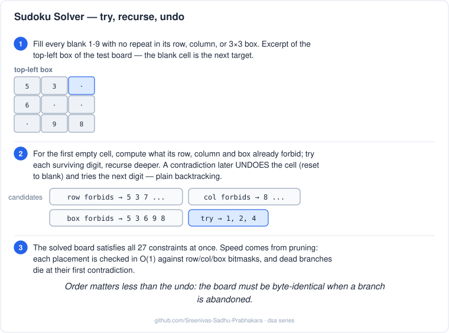

# Sudoku Solver

> Striver SDE Sheet 057 · Day 10 Backtracking — backtracking with row/column/box bitmasks; candidate checks are single ANDs, undo is a bit clear. Go, stdlib only, tested.

## Problem

Fill a 9×9 Sudoku (empty cells given as 0) so every row, column and 3×3 box contains 1–9 exactly once, or report that the clues are contradictory.

## Approach

Plain cell-by-cell backtracking, made brisk by representation: each row, column and box carries a 9-bit mask of used digits, so "can v go here?" is one AND across three masks and undo is a bit-clear — no 9-cell scans anywhere. The box index collapses to `(r/3)*3 + c/3`. A pre-pass seeds the masks from the clues and rejects boards whose givens already conflict, which pure solvers silently mis-solve. The test suite checks the solved grid against the rules and that no clue was overwritten — not against one hardcoded answer.

**Complexity:** exponential worst case (Sudoku is NP-complete generalized); trivial on real puzzles.

## Visual walkthrough

Read the picture top to bottom — each numbered frame is one moment of the algorithm
running on this repo's test example.

## Run

    go test ./...   # verify
    go run .        # demo

---

One of 191 repos solving Striver's SDE Sheet in Go — stdlib only, one problem per repo, every solution tested. Browse the set: [`dsa-*` repos](https://github.com/Sreenivas-Sadhu-Prabhakara?tab=repositories&q=dsa-&type=source).
